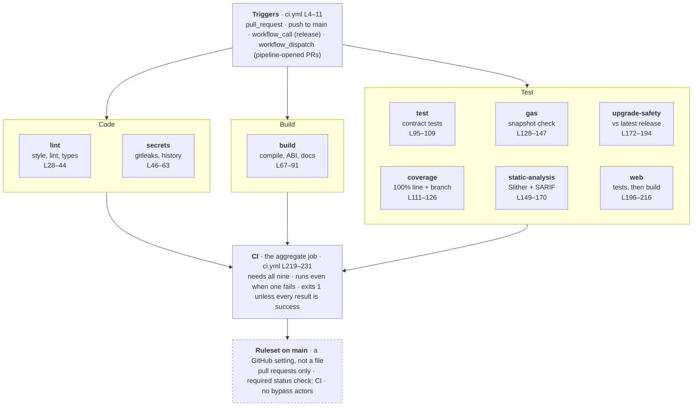

# How CI is implemented

As of 2026-10-07. Line numbers refer to commit [`d3a7a3b`](https://github.com/Rong0715/assert-dao/commit/d3a7a3b52c9eb181625707772ca988a7d69a5559), and every reference links to those lines at that commit.

## Pipeline map

All nine jobs start together, with no ordering between them; the `CI` job is the only one that waits. Line numbers in the boxes are in `ci.yml`.

## Item by item

Each row is one thing CI does: the workflow step that runs it, then the script or config that step leads to.

### Workflow settings

| Item              | How it is done                                                            | Where                                                                                                                                                                                                                                                                                                                                                                                                          |
| ----------------- | ------------------------------------------------------------------------- | -------------------------------------------------------------------------------------------------------------------------------------------------------------------------------------------------------------------------------------------------------------------------------------------------------------------------------------------------------------------------------------------------------------- |
| Triggers          | Pull requests, pushes to `main`, calls from other workflows, manual runs  | [ci.yml L4–11](https://github.com/Rong0715/assert-dao/blob/d3a7a3b52c9eb181625707772ca988a7d69a5559/.github/workflows/ci.yml#L4-L11)                                                                                                                                                                                                                                                                           |
| Token permissions | Read-only by default; only the Slither job may also write security events | [ci.yml L13–14](https://github.com/Rong0715/assert-dao/blob/d3a7a3b52c9eb181625707772ca988a7d69a5559/.github/workflows/ci.yml#L13-L14), [L152–154](https://github.com/Rong0715/assert-dao/blob/d3a7a3b52c9eb181625707772ca988a7d69a5559/.github/workflows/ci.yml#L152-L154)                                                                                                                                    |
| Concurrency       | One run per ref; a newer push cancels the older run on pull requests only | [ci.yml L16–18](https://github.com/Rong0715/assert-dao/blob/d3a7a3b52c9eb181625707772ca988a7d69a5559/.github/workflows/ci.yml#L16-L18)                                                                                                                                                                                                                                                                         |
| Scanner versions  | Slither 0.11.6 and gitleaks 8.30.1, the latter with its SHA-256           | [ci.yml L20–23](https://github.com/Rong0715/assert-dao/blob/d3a7a3b52c9eb181625707772ca988a7d69a5559/.github/workflows/ci.yml#L20-L23)                                                                                                                                                                                                                                                                         |
| Runner            | Every job on `ubuntu-24.04`, not `latest`                                 | [ci.yml L30](https://github.com/Rong0715/assert-dao/blob/d3a7a3b52c9eb181625707772ca988a7d69a5559/.github/workflows/ci.yml#L30)                                                                                                                                                                                                                                                                                |
| Actions           | Pinned by commit SHA, with the version as a comment                       | [ci.yml L32](https://github.com/Rong0715/assert-dao/blob/d3a7a3b52c9eb181625707772ca988a7d69a5559/.github/workflows/ci.yml#L32), [action.yml L12](https://github.com/Rong0715/assert-dao/blob/d3a7a3b52c9eb181625707772ca988a7d69a5559/.github/actions/setup/action.yml#L12), [L18](https://github.com/Rong0715/assert-dao/blob/d3a7a3b52c9eb181625707772ca988a7d69a5559/.github/actions/setup/action.yml#L18) |
| Checkout          | Submodules fetched; the token is not left in the clone                    | [ci.yml L32–35](https://github.com/Rong0715/assert-dao/blob/d3a7a3b52c9eb181625707772ca988a7d69a5559/.github/workflows/ci.yml#L32-L35)                                                                                                                                                                                                                                                                         |
| Toolchain         | Node from `.nvmrc`, Foundry v1.5.0, `npm ci` from the lockfile            | [ci.yml L36](https://github.com/Rong0715/assert-dao/blob/d3a7a3b52c9eb181625707772ca988a7d69a5559/.github/workflows/ci.yml#L36) → [action.yml L12–25](https://github.com/Rong0715/assert-dao/blob/d3a7a3b52c9eb181625707772ca988a7d69a5559/.github/actions/setup/action.yml#L12-L25)                                                                                                                           |

### Code

| Item                          | How it is done                                                                         | Where                                                                                                                                                                                                                                                                                                                                                                                                                                                                                                                                                       |
| ----------------------------- | -------------------------------------------------------------------------------------- | ----------------------------------------------------------------------------------------------------------------------------------------------------------------------------------------------------------------------------------------------------------------------------------------------------------------------------------------------------------------------------------------------------------------------------------------------------------------------------------------------------------------------------------------------------------- |
| Solidity format and lint      | `forge fmt --check`, `forge lint --deny notes`, `solhint --max-warnings 0`             | [ci.yml L37–38](https://github.com/Rong0715/assert-dao/blob/d3a7a3b52c9eb181625707772ca988a7d69a5559/.github/workflows/ci.yml#L37-L38) → [package.json L25](https://github.com/Rong0715/assert-dao/blob/d3a7a3b52c9eb181625707772ca988a7d69a5559/package.json#L25) → [.solhint.json L1–16](https://github.com/Rong0715/assert-dao/blob/d3a7a3b52c9eb181625707772ca988a7d69a5559/contracts/.solhint.json#L1-L16), [foundry.toml L56–63](https://github.com/Rong0715/assert-dao/blob/d3a7a3b52c9eb181625707772ca988a7d69a5559/contracts/foundry.toml#L56-L63) |
| Web lint                      | ESLint with strict type-checked rules, zero warnings allowed                           | [ci.yml L39–40](https://github.com/Rong0715/assert-dao/blob/d3a7a3b52c9eb181625707772ca988a7d69a5559/.github/workflows/ci.yml#L39-L40) → [web/package.json L11](https://github.com/Rong0715/assert-dao/blob/d3a7a3b52c9eb181625707772ca988a7d69a5559/web/package.json#L11) → [eslint.config.js L12–18](https://github.com/Rong0715/assert-dao/blob/d3a7a3b52c9eb181625707772ca988a7d69a5559/web/eslint.config.js#L12-L18)                                                                                                                                   |
| Web types                     | `tsc --noEmit`                                                                         | [ci.yml L41–42](https://github.com/Rong0715/assert-dao/blob/d3a7a3b52c9eb181625707772ca988a7d69a5559/.github/workflows/ci.yml#L41-L42) → [web/package.json L10](https://github.com/Rong0715/assert-dao/blob/d3a7a3b52c9eb181625707772ca988a7d69a5559/web/package.json#L10)                                                                                                                                                                                                                                                                                  |
| Formatting of everything else | `prettier --check .`; Solidity is left to `forge fmt`                                  | [ci.yml L43–44](https://github.com/Rong0715/assert-dao/blob/d3a7a3b52c9eb181625707772ca988a7d69a5559/.github/workflows/ci.yml#L43-L44) → [package.json L27](https://github.com/Rong0715/assert-dao/blob/d3a7a3b52c9eb181625707772ca988a7d69a5559/package.json#L27) → [.prettierrc.json L1–4](https://github.com/Rong0715/assert-dao/blob/d3a7a3b52c9eb181625707772ca988a7d69a5559/.prettierrc.json#L1-L4), [.prettierignore L12–14](https://github.com/Rong0715/assert-dao/blob/d3a7a3b52c9eb181625707772ca988a7d69a5559/.prettierignore#L12-L14)           |
| Secret scan                   | gitleaks over the whole history: full clone, checksum-verified binary, redacted output | [ci.yml L50–54](https://github.com/Rong0715/assert-dao/blob/d3a7a3b52c9eb181625707772ca988a7d69a5559/.github/workflows/ci.yml#L50-L54), [L56–61](https://github.com/Rong0715/assert-dao/blob/d3a7a3b52c9eb181625707772ca988a7d69a5559/.github/workflows/ci.yml#L56-L61), [L62–63](https://github.com/Rong0715/assert-dao/blob/d3a7a3b52c9eb181625707772ca988a7d69a5559/.github/workflows/ci.yml#L62-L63) → [.gitleaks.toml L3–8](https://github.com/Rong0715/assert-dao/blob/d3a7a3b52c9eb181625707772ca988a7d69a5559/.gitleaks.toml#L3-L8)                 |

### Build

| Item                   | How it is done                                                                  | Where                                                                                                                                                                                                                                                                                                                                                                                                                     |
| ---------------------- | ------------------------------------------------------------------------------- | ------------------------------------------------------------------------------------------------------------------------------------------------------------------------------------------------------------------------------------------------------------------------------------------------------------------------------------------------------------------------------------------------------------------------- |
| Compile                | `forge build --sizes`; compiler pinned to 0.8.30, and a warning fails the build | [ci.yml L76–78](https://github.com/Rong0715/assert-dao/blob/d3a7a3b52c9eb181625707772ca988a7d69a5559/.github/workflows/ci.yml#L76-L78) → [foundry.toml L9–15](https://github.com/Rong0715/assert-dao/blob/d3a7a3b52c9eb181625707772ca988a7d69a5559/contracts/foundry.toml#L9-L15)                                                                                                                                         |
| ABI in sync            | Regenerates the typed ABI and fails if the committed file differs               | [ci.yml L79–80](https://github.com/Rong0715/assert-dao/blob/d3a7a3b52c9eb181625707772ca988a7d69a5559/.github/workflows/ci.yml#L79-L80) → [package.json L20](https://github.com/Rong0715/assert-dao/blob/d3a7a3b52c9eb181625707772ca988a7d69a5559/package.json#L20) → [abi.mjs L22–30](https://github.com/Rong0715/assert-dao/blob/d3a7a3b52c9eb181625707772ca988a7d69a5559/scripts/abi.mjs#L22-L30)                       |
| Storage layout in sync | Regenerates the layout snapshot and fails if the committed file differs         | [ci.yml L81–82](https://github.com/Rong0715/assert-dao/blob/d3a7a3b52c9eb181625707772ca988a7d69a5559/.github/workflows/ci.yml#L81-L82) → [package.json L22](https://github.com/Rong0715/assert-dao/blob/d3a7a3b52c9eb181625707772ca988a7d69a5559/package.json#L22) → [storage-layout.mjs L39–53](https://github.com/Rong0715/assert-dao/blob/d3a7a3b52c9eb181625707772ca988a7d69a5559/scripts/storage-layout.mjs#L39-L53) |
| Reference docs         | `forge doc` into `contracts/docs`                                               | [ci.yml L83–84](https://github.com/Rong0715/assert-dao/blob/d3a7a3b52c9eb181625707772ca988a7d69a5559/.github/workflows/ci.yml#L83-L84) → [package.json L18](https://github.com/Rong0715/assert-dao/blob/d3a7a3b52c9eb181625707772ca988a7d69a5559/package.json#L18) → [foundry.toml L65–67](https://github.com/Rong0715/assert-dao/blob/d3a7a3b52c9eb181625707772ca988a7d69a5559/contracts/foundry.toml#L65-L67)           |
| Build artifact         | Uploads the compiled contract JSON and the docs as `contracts`                  | [ci.yml L85–91](https://github.com/Rong0715/assert-dao/blob/d3a7a3b52c9eb181625707772ca988a7d69a5559/.github/workflows/ci.yml#L85-L91)                                                                                                                                                                                                                                                                                    |

### Test

| Item                  | How it is done                                                                                                            | Where                                                                                                                                                                                                                                                                                                                                                                                                                                                                                                                                                                                                                                                                                                                                                                                                                                                 |
| --------------------- | ------------------------------------------------------------------------------------------------------------------------- | ----------------------------------------------------------------------------------------------------------------------------------------------------------------------------------------------------------------------------------------------------------------------------------------------------------------------------------------------------------------------------------------------------------------------------------------------------------------------------------------------------------------------------------------------------------------------------------------------------------------------------------------------------------------------------------------------------------------------------------------------------------------------------------------------------------------------------------------------------- |
| Contract tests        | `forge test -vvv` without the gas tests, under the `ci` profile: 5,000 fuzz runs, 256 invariant runs at depth 128         | [ci.yml L98–100](https://github.com/Rong0715/assert-dao/blob/d3a7a3b52c9eb181625707772ca988a7d69a5559/.github/workflows/ci.yml#L98-L100), [L107–109](https://github.com/Rong0715/assert-dao/blob/d3a7a3b52c9eb181625707772ca988a7d69a5559/.github/workflows/ci.yml#L107-L109) → [foundry.toml L47–54](https://github.com/Rong0715/assert-dao/blob/d3a7a3b52c9eb181625707772ca988a7d69a5559/contracts/foundry.toml#L47-L54)                                                                                                                                                                                                                                                                                                                                                                                                                            |
| Coverage              | `forge coverage` to lcov; fails below 100% lines or branches; table in the run summary; lcov uploaded                     | [ci.yml L120–126](https://github.com/Rong0715/assert-dao/blob/d3a7a3b52c9eb181625707772ca988a7d69a5559/.github/workflows/ci.yml#L120-L126) → [package.json L31](https://github.com/Rong0715/assert-dao/blob/d3a7a3b52c9eb181625707772ca988a7d69a5559/package.json#L31) → [coverage.mjs L16–30](https://github.com/Rong0715/assert-dao/blob/d3a7a3b52c9eb181625707772ca988a7d69a5559/scripts/coverage.mjs#L16-L30), [L59–64](https://github.com/Rong0715/assert-dao/blob/d3a7a3b52c9eb181625707772ca988a7d69a5559/scripts/coverage.mjs#L59-L64), [L66–73](https://github.com/Rong0715/assert-dao/blob/d3a7a3b52c9eb181625707772ca988a7d69a5559/scripts/coverage.mjs#L66-L73)                                                                                                                                                                           |
| Gas                   | Re-runs the gas tests and fails if a figure differs from the committed snapshot; prints the table in the run summary      | [ci.yml L137–138](https://github.com/Rong0715/assert-dao/blob/d3a7a3b52c9eb181625707772ca988a7d69a5559/.github/workflows/ci.yml#L137-L138), [L139–147](https://github.com/Rong0715/assert-dao/blob/d3a7a3b52c9eb181625707772ca988a7d69a5559/.github/workflows/ci.yml#L139-L147) → [package.json L33](https://github.com/Rong0715/assert-dao/blob/d3a7a3b52c9eb181625707772ca988a7d69a5559/package.json#L33) → [Gas.t.sol L18–22](https://github.com/Rong0715/assert-dao/blob/d3a7a3b52c9eb181625707772ca988a7d69a5559/contracts/test/Gas.t.sol#L18-L22), [GasTest.json L1–9](https://github.com/Rong0715/assert-dao/blob/d3a7a3b52c9eb181625707772ca988a7d69a5559/contracts/snapshots/GasTest.json#L1-L9), [foundry.toml L36–37](https://github.com/Rong0715/assert-dao/blob/d3a7a3b52c9eb181625707772ca988a7d69a5559/contracts/foundry.toml#L36-L37) |
| Static analysis       | Slither at the pinned version; fails on low severity and above; SARIF sent to code scanning when the repository is public | [ci.yml L161–164](https://github.com/Rong0715/assert-dao/blob/d3a7a3b52c9eb181625707772ca988a7d69a5559/.github/workflows/ci.yml#L161-L164), [L165–170](https://github.com/Rong0715/assert-dao/blob/d3a7a3b52c9eb181625707772ca988a7d69a5559/.github/workflows/ci.yml#L165-L170) → [slither.config.json L2–4](https://github.com/Rong0715/assert-dao/blob/d3a7a3b52c9eb181625707772ca988a7d69a5559/contracts/slither.config.json#L2-L4)                                                                                                                                                                                                                                                                                                                                                                                                                |
| Upgrade safety        | OpenZeppelin's validator on the contract, and against the build of the latest release when one exists                     | [ci.yml L181–192](https://github.com/Rong0715/assert-dao/blob/d3a7a3b52c9eb181625707772ca988a7d69a5559/.github/workflows/ci.yml#L181-L192), [L193–194](https://github.com/Rong0715/assert-dao/blob/d3a7a3b52c9eb181625707772ca988a7d69a5559/.github/workflows/ci.yml#L193-L194) → [package.json L23](https://github.com/Rong0715/assert-dao/blob/d3a7a3b52c9eb181625707772ca988a7d69a5559/package.json#L23) → [upgrade-safety.mjs L18–38](https://github.com/Rong0715/assert-dao/blob/d3a7a3b52c9eb181625707772ca988a7d69a5559/scripts/upgrade-safety.mjs#L18-L38), [foundry.toml L17–20](https://github.com/Rong0715/assert-dao/blob/d3a7a3b52c9eb181625707772ca988a7d69a5559/contracts/foundry.toml#L17-L20)                                                                                                                                        |
| Web unit tests        | `vitest run --project unit`                                                                                               | [ci.yml L205–206](https://github.com/Rong0715/assert-dao/blob/d3a7a3b52c9eb181625707772ca988a7d69a5559/.github/workflows/ci.yml#L205-L206) → [web/package.json L12](https://github.com/Rong0715/assert-dao/blob/d3a7a3b52c9eb181625707772ca988a7d69a5559/web/package.json#L12) → [vite.config.ts L12–15](https://github.com/Rong0715/assert-dao/blob/d3a7a3b52c9eb181625707772ca988a7d69a5559/web/vite.config.ts#L12-L15)                                                                                                                                                                                                                                                                                                                                                                                                                             |
| Web integration tests | Compiles the contract, then runs the client library against it on a local chain                                           | [ci.yml L207–209](https://github.com/Rong0715/assert-dao/blob/d3a7a3b52c9eb181625707772ca988a7d69a5559/.github/workflows/ci.yml#L207-L209) → [web/package.json L13](https://github.com/Rong0715/assert-dao/blob/d3a7a3b52c9eb181625707772ca988a7d69a5559/web/package.json#L13) → [vite.config.ts L16–26](https://github.com/Rong0715/assert-dao/blob/d3a7a3b52c9eb181625707772ca988a7d69a5559/web/vite.config.ts#L16-L26)                                                                                                                                                                                                                                                                                                                                                                                                                             |
| Web build             | `tsc --noEmit && vite build`; `web/dist` uploaded as `web`                                                                | [ci.yml L210–216](https://github.com/Rong0715/assert-dao/blob/d3a7a3b52c9eb181625707772ca988a7d69a5559/.github/workflows/ci.yml#L210-L216) → [web/package.json L8](https://github.com/Rong0715/assert-dao/blob/d3a7a3b52c9eb181625707772ca988a7d69a5559/web/package.json#L8)                                                                                                                                                                                                                                                                                                                                                                                                                                                                                                                                                                          |

### Gate

| Item               | How it is done                                                                                       | Where                                                                                                                                                                                                                                                                                                                                                                                                                                                                                                                                                           |
| ------------------ | ---------------------------------------------------------------------------------------------------- | --------------------------------------------------------------------------------------------------------------------------------------------------------------------------------------------------------------------------------------------------------------------------------------------------------------------------------------------------------------------------------------------------------------------------------------------------------------------------------------------------------------------------------------------------------------- |
| Aggregate check    | Job `CI` waits for all nine, runs even when one failed, and exits 1 unless every result is `success` | [ci.yml L218–231](https://github.com/Rong0715/assert-dao/blob/d3a7a3b52c9eb181625707772ca988a7d69a5559/.github/workflows/ci.yml#L218-L231): `needs` [L222](https://github.com/Rong0715/assert-dao/blob/d3a7a3b52c9eb181625707772ca988a7d69a5559/.github/workflows/ci.yml#L222), `always()` [L221](https://github.com/Rong0715/assert-dao/blob/d3a7a3b52c9eb181625707772ca988a7d69a5559/.github/workflows/ci.yml#L221), loop [L227–231](https://github.com/Rong0715/assert-dao/blob/d3a7a3b52c9eb181625707772ca988a7d69a5559/.github/workflows/ci.yml#L227-L231) |
| Required on `main` | Ruleset `main`: pull requests only, status check `CI` required, no bypass actors                     | GitHub setting, not a file: [ruleset](https://github.com/Rong0715/assert-dao/rules/24639912); expected by [README L101](https://github.com/Rong0715/assert-dao/blob/d3a7a3b52c9eb181625707772ca988a7d69a5559/README.md#L101)                                                                                                                                                                                                                                                                                                                                    |
